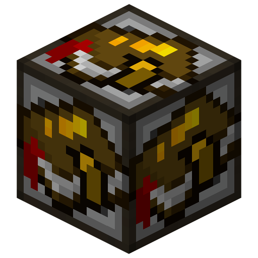
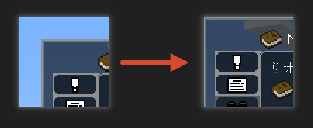
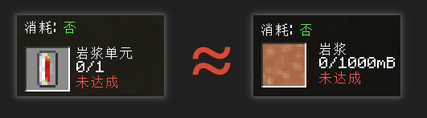

# BQ Ext

BetterQuesting 增强。

---

## 下载
| GTNH  | Download                                                                                                                           |
|-------|------------------------------------------------------------------------------------------------------------------------------------|
| 2.9.0 |  |

> [!WARNING]
> 0.1.0 → 0.2.X+ bqae 更名为 bqext

---

## 功能

- ### 任务接口

支持从 AE 网络检测和交付任务物品。

将接口方块连入AE网络，在有BQ队伍的情况下右键未绑定的接口方块，即可将接口添加进队伍。

> [!WARNING]
> 0.1.0 → 0.2.X+ 破坏性更新，旧的任务接口会被删除。

- ### 背包任务入口

在背包的ServerUtilities侧边栏添加任务按钮。

- ### 全屏任务界面

去除任务界面的边距，让任务界面完全填充MC窗口。

> [!NOTE]
> 默认关闭，可随时在MOD配置界面开关。

- ### 流体识别增强

任务中的单元、桶、流体容器，可以等效为流体。同时检查玩家背包的流体容器及AE网络中的流体。

> [!NOTE]
> 仅对不消耗的任务有效
